<div align="center">

<picture>
  <source media="(prefers-color-scheme: dark)" srcset=".github/assets/banner-dark.svg">
  <source media="(prefers-color-scheme: light)" srcset=".github/assets/banner-light.svg">
  
</picture>

<h3>A maker sends a photo and a voice note. The agents do the rest.</h3>

<p>
India's weavers, block printers and potters make things buyers abroad want.<br>
What stops the sale is <b>everything around it</b>: the English listing, the export price, the paperwork, the payment, the split.<br>
<b>Haat</b> is the export desk that does all of it, in the maker's own language, and <b>PayPal</b> settles every dollar.
</p>

<p>
<a href="#how-paypal-is-used"></a>
<a href="#how-the-agents-work"></a>
<a href="#sell-to-agents-too"></a>
<a href="#stack"></a>
<a href="#stack"></a>
<a href="#stack"></a>
<a href="LICENSE"></a>
</p>

<p>
<a href="#the-problem"><b>Problem</b></a> ·
<a href="#watch-it-run"><b>Watch it run</b></a> ·
<a href="#the-loop-in-55-seconds"><b>The loop</b></a> ·
<a href="#every-dollar-traced"><b>Money</b></a> ·
<a href="#how-paypal-is-used"><b>PayPal</b></a> ·
<a href="#how-the-agents-work"><b>Agents</b></a> ·
<a href="#run-it"><b>Run it</b></a>
</p>

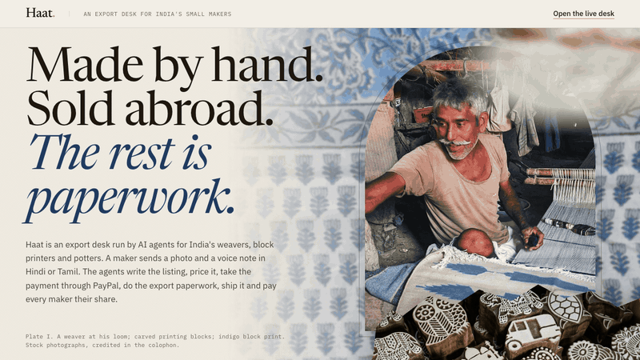

<sub>The landing page, scrolled: <b>the craft → the paperwork pile → <i>"so he sends a voice note"</i> → Hindi becomes English → priced → published</b>.</sub>

</div>

<br>

## The problem

> *Picture a block printer in Bagru, Rajasthan. Buyers abroad would love his cloth.*
> *Between his workshop and a buyer in Ohio sit seven jobs, and none of them is printing cloth.*

| What selling abroad means | Who does it today | Who does it in Haat |
|---|---|---|
| A listing in English that a buyer abroad trusts | a cousin, a middleman, or nobody | the **listing agent** reads the photo and the Hindi note together |
| An export price that survives fees and currency conversion | guesswork | **deterministic pricing**, worked backwards from the maker's rupees |
| A way to get paid from abroad | a middleman's cut | **PayPal** checkout, or the buyer's own **AI agent** preparing a PayPal order |
| A GST export invoice under a Letter of Undertaking | a chartered accountant, later | the **autopilot**, right after capture |
| The RBI purpose code on the inward remittance | rarely done right | chosen and checked by the **compliance step** (P0103) |
| Tracking on the payment, for seller protection | skipped | attached to the **PayPal capture** with Orders v2 `/track` |
| Splitting the money with everyone who made it | cash, eventually | **UPI requests** to each maker, or **PayPal Payouts** |

PayPal is how small Indian sellers get paid from abroad. Since 2021 that cross-border flow is PayPal's whole business in India. And buyers are starting to shop through AI agents, which can only buy from catalogues that are machine-readable and payable. **Haat makes a weaver with no website agent-ready.**

<br>

## Watch it run

<div align="center">
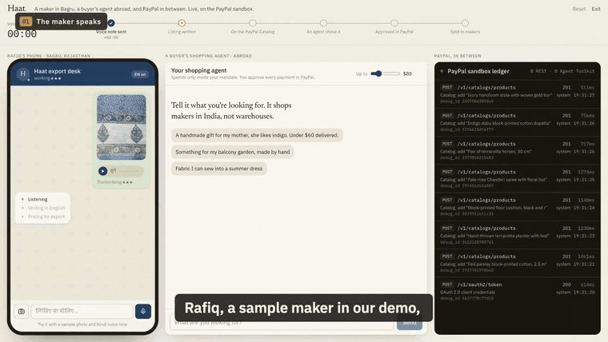

<sub>Cut from the recorded demo of the real app against the PayPal sandbox and live Gemini. Waits are sped up and labelled on screen. Nothing is faked.</sub>
</div>

<details>
<summary><b>▶ Try the same run yourself in two minutes</b></summary>

<br>

1. Start the app ([Run it](#run-it)) and open **`/app/live`**.
2. Press **Send Rafiq's voice note**. No microphone needed: it sends a sample photo and a 25-second Hindi voice note ([photo](server/seed/images/studio-raw-photo.jpg), [voice note](server/seed/images/sample-voice-hi.wav)). The stopwatch starts, and every Hindi message shows its English underneath.
3. In about 20 to 30 seconds the listing appears with the price, the rupees the maker receives and the HS code. Tap **Publish**: a `POST /v1/catalogs/products` lands on the ledger.
4. Press **Ask the buyer's agent**, or type to it: *"A handmade gift for my mother, she likes indigo. Under $60 delivered."* It searches, recommends and prepares a PayPal order. An approval card appears.
5. Approve in the PayPal popup with a **sandbox Personal account outside India**. The capture lands on the ledger and the autopilot runs: export invoice, tracking on the capture, each maker's share, and a Hindi message (text and voice) on the maker's phone.
6. Watch the stopwatch stop and the *"Where the money went"* sheet rise. Open the order for the printable GST export invoice.
7. In the seller chat, try: `बर्लिन की दुकान anna@example.com को 20 दुपट्टे का इनवॉइस भेज दो, 15 डॉलर एक का`. The agent confirms, then sends a PayPal invoice through the Agent Toolkit.

</details>

<br>

## The loop in 55 seconds

<picture>
  <source media="(prefers-color-scheme: dark)" srcset=".github/assets/loop-dark.svg">
  <source media="(prefers-color-scheme: light)" srcset=".github/assets/loop-light.svg">
  
</picture>

Turmeric steps are Haat's agents. Indigo steps are real PayPal sandbox calls, and every one of them lands on the ledger with its status, latency and `PayPal-Debug-Id`. The full sequence, as it runs:

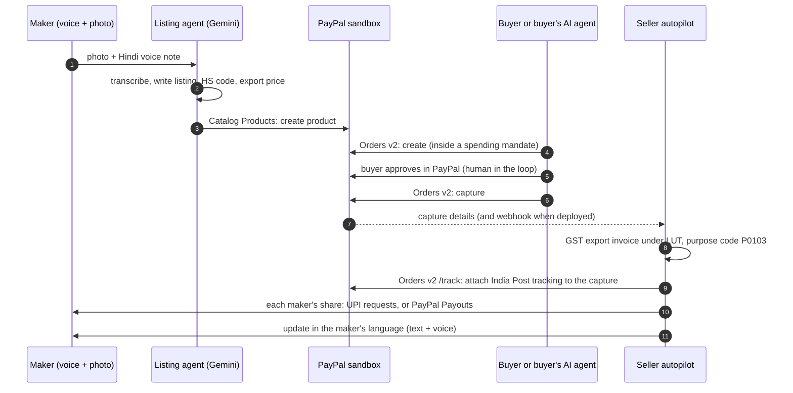

<br>

## Every dollar, traced

<picture>
  <source media="(prefers-color-scheme: dark)" srcset=".github/assets/money-dark.svg">
  <source media="(prefers-color-scheme: light)" srcset=".github/assets/money-light.svg">
  
</picture>

These are the numbers from the recorded sandbox order **HT-01041**. Every order draws the payment this way: the buyer's dollars peel off into shipping, PayPal's fee, GST on the fee and conversion, and the rest runs on to the cooperative and splits into one strand per maker, by name, in rupees. Product pages show the same picture as an estimate before you buy.

> [!NOTE]
> **Why UPI and not PayPal Payouts?** PayPal accounts registered in India can receive international payments but cannot *send* PayPal Payouts. Haat designs around that instead of hiding it: **PayPal brings the dollars in, UPI carries the rupees the last mile.** With a marketplace account outside India, set `PAYOUT_MODE=paypal` and the same step uses Payouts.

<br>

## Where the makers are

The sample cooperatives, and where their first buyers are in the demo story. Drag, zoom and click a pin.

```geojson
{
  "type": "FeatureCollection",
  "features": [
    { "type": "Feature", "properties": { "title": "Bagru Chhipa Prints · Bagru, Rajasthan", "description": "Rafiq, Shabana and Imran Chhipa. Hand block printing, dabu mud-resist and indigo. Sample maker profile.", "marker-color": "#1f3a5f", "marker-size": "large", "marker-symbol": "star" }, "geometry": { "type": "Point", "coordinates": [75.5453, 26.8106] } },
    { "type": "Feature", "properties": { "title": "Chanderi handloom · Chanderi, Madhya Pradesh", "description": "Meera Devi and three weavers. Silk-cotton with zari, on pit looms. Sample maker profile.", "marker-color": "#a23b2a", "marker-size": "large", "marker-symbol": "star" }, "geometry": { "type": "Point", "coordinates": [78.1338, 24.7175] } },
    { "type": "Feature", "properties": { "title": "Villianur terracotta · Puducherry", "description": "Kalaiselvi Murugan. Hand-modelled terracotta horses, wood-kiln fired. Speaks Tamil to the desk. Sample maker profile.", "marker-color": "#c8902e", "marker-size": "large", "marker-symbol": "star" }, "geometry": { "type": "Point", "coordinates": [79.7604, 11.918] } },
    { "type": "Feature", "properties": { "title": "A buyer in Ohio", "description": "The landing page story: a dupatta from Bagru, paid with PayPal, tracked by India Post EMS.", "marker-color": "#3f6b4a", "marker-symbol": "shop" }, "geometry": { "type": "Point", "coordinates": [-82.9988, 39.9612] } },
    { "type": "Feature", "properties": { "title": "A shop in Berlin", "description": "The wholesale example: 20 dupattas invoiced through the PayPal Agent Toolkit, asked for in Hindi.", "marker-color": "#3f6b4a", "marker-symbol": "shop" }, "geometry": { "type": "Point", "coordinates": [13.405, 52.52] } },
    { "type": "Feature", "properties": { "title": "Bagru → Ohio", "description": "Retail order, PayPal checkout, tracking attached to the capture", "stroke": "#1f3a5f", "stroke-width": 2.5 }, "geometry": { "type": "LineString", "coordinates": [[75.5453, 26.8106], [-82.9988, 39.9612]] } },
    { "type": "Feature", "properties": { "title": "Bagru → Berlin", "description": "Wholesale PayPal invoice", "stroke": "#c8902e", "stroke-width": 2.5 }, "geometry": { "type": "LineString", "coordinates": [[75.5453, 26.8106], [13.405, 52.52]] } }
  ]
}
```

<br>

## How PayPal is used

Every call below is a real sandbox request, and each appears on the Ledger page with its status, latency and `PayPal-Debug-Id`.

| Capability | API | Where | Why it matters |
|---|---|---|---|
| OAuth 2.0, token cache | `/v1/oauth2/token` | `server/src/paypal/client.ts` | single-flight refresh, 401 retry |
| Checkout | Orders v2 create + capture, JS SDK Smart Buttons | `server/src/paypal/api.ts`, `web/src/ui.tsx` | idempotent (`PayPal-Request-Id`), item breakdown, `payer-action` link for agents, `ORDER_ALREADY_CAPTURED` handled |
| Catalogue | Catalog Products v1 | `server/src/domain/commerce.ts` | every live listing is mirrored into the PayPal Catalog |
| Seller protection | Orders v2 `/track` | `server/src/agents/autopilot.ts` | tracking attached to the capture, buyer notified |
| Paying the makers | Payouts v1, or a UPI split | `server/src/agents/autopilot.ts` | `PAYOUT_MODE=paypal`: one Payouts batch per order. `PAYOUT_MODE=upi`: each share becomes a one-tap UPI request |
| Wholesale | Invoicing v2 via the **PayPal Agent Toolkit** | `server/src/agents/seller.ts`, `server/src/paypal/toolkit.ts` | the seller says *"send an invoice to the shop in Berlin"* in Hindi |
| Reporting | Agent Toolkit `list_transactions`, `get_merchant_insights` | `server/src/paypal/toolkit.ts` | the seller can ask what came in |
| Disputes | Disputes v1, `provide-evidence` (multipart), `accept-claim` | `server/src/agents/disputes.ts` | evidence drafted from the tracking Haat already attached |
| Webhooks | register, `verify-webhook-signature` | `server/src/index.ts` | `CHECKOUT.ORDER.APPROVED` captures server-side if a tab closed |
| Agentic commerce | MCP server (Streamable HTTP) over Orders v2 | `server/src/mcp/server.ts` | outside agents can search and start a PayPal checkout that a human approves |

The official [`@paypal/agent-toolkit`](https://github.com/paypal/agent-toolkit) tools are converted from their Zod schemas into Gemini function declarations, so the seller agent calls **PayPal's own tool implementations**. Toolkit calls appear on the ledger as `KIT` rows.

<br>

## How the agents work

All models are Google Gemini through `@google/genai` (`server/src/ai/gemini.ts`), with automatic fallback across models when one is overloaded. **Agents prepare and explain. PayPal and people move the money.**

<details>
<summary><b>🎙️ Listing agent</b>: photo + voice note → honest English listing</summary>

<br>

`server/src/agents/listing.ts`. One multimodal call reads the photo and the voice note together, transcribes the original language, translates, writes the listing, proposes an HS code with a reason, and extracts the asking price and stock. Structured output via JSON schema. **The prompt forbids claims the maker did not make** ("master artisan", "natural dye" unless said), and the UI shows the maker's original words next to the English.

</details>

<details>
<summary><b>🧮 Export pricing</b>: deterministic, no model involved</summary>

<br>

`server/src/domain/pricing.ts`. Works backwards from the maker's rupees through PayPal's percentage and fixed fee, GST on the fee and the conversion spread, using a live mid-market rate. The reply to the maker quotes the number they will actually receive, not the number they asked for. In the recorded run: *asked ₹1,200 → buyer pays $17.99 → maker receives about ₹1,513* at 93.85 INR/USD.

</details>

<details>
<summary><b>💬 Seller agent</b>: talks in Hindi or Tamil, acts through PayPal</summary>

<br>

`server/src/agents/seller.ts`. A tool-using agent with the Agent Toolkit tools plus Haat's own. Voice notes are transcribed first. Every reply has a **Listen** button that speaks it in Hindi or Tamil (Gemini TTS), and sale news arrives as a voice note for makers who would rather hear than read.

</details>

<details>
<summary><b>🛍️ Buyer agent</b>: shops inside a spending mandate, can never pay on its own</summary>

<br>

`server/src/agents/buyer.ts`. A shopping agent bound by a mandate the buyer sets (a ceiling on the landed price and a country to ship to). It searches, checks the landed cost and **creates a real PayPal order, but cannot pay**: the human approves in PayPal. Mandates are enforced before PayPal is ever called.

</details>

<details>
<summary><b>🧾 Autopilot</b>: everything after the capture</summary>

<br>

`server/src/agents/autopilot.ts`. A compliance step chooses the RBI purpose code and GST treatment and checks the HS code. Then it writes the GST export invoice under LUT, attaches tracking to the capture, splits the money (Payouts or UPI) and writes the maker an update in their language.

</details>

<details>
<summary><b>⚖️ Dispute desk</b>: evidence it already holds</summary>

<br>

`server/src/agents/disputes.ts`. Reads real PayPal disputes, matches each to the order, and recommends sending proof of fulfilment (the tracking Haat attached) or refunding. The seller decides; Haat calls `provide-evidence` or `accept-claim`.

</details>

<br>

## Sell to agents, too

Haat is also an **MCP server**. Point any MCP client at `/mcp` and it gets four tools: `search_catalog`, `product_details`, `request_checkout` (returns the PayPal approval link) and `order_status`. After approval, PayPal returns the human to `/checkout/return`, which captures and starts the autopilot.

```json
{ "mcpServers": { "haat": { "type": "http", "url": "https://<your-deployment>/mcp" } } }
```

```bash
cd server && CHECKOUT=1 npx tsx scripts/mcp-check.ts https://<your-deployment>/mcp
```

<br>

## Screens

| | |
|---|---|
| 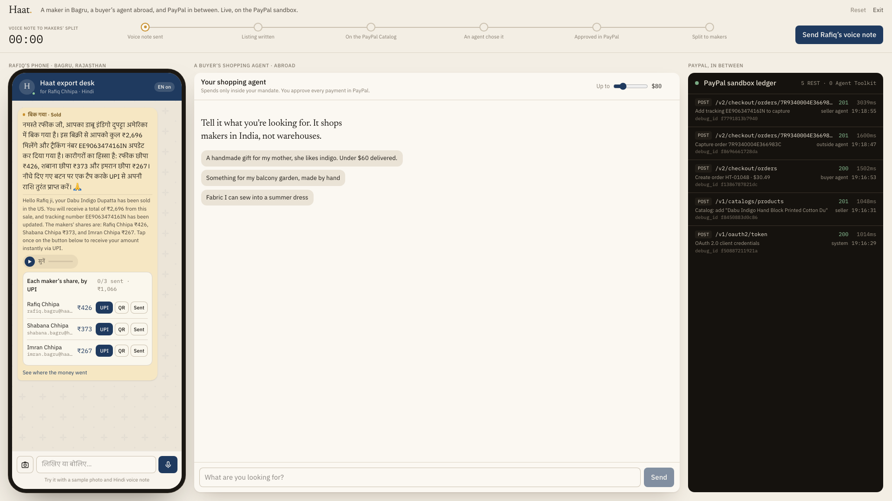 | 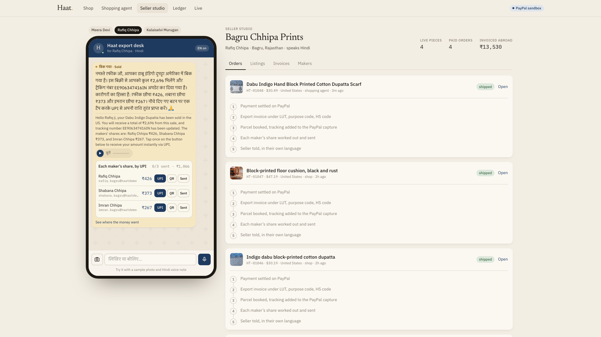 |
| **Live stage.** The maker's phone, the buyer's agent and the PayPal ledger on one screen, with a stopwatch. | **Seller studio.** Voice + photo in, a priced listing out, the maker's words beside the English. |
| 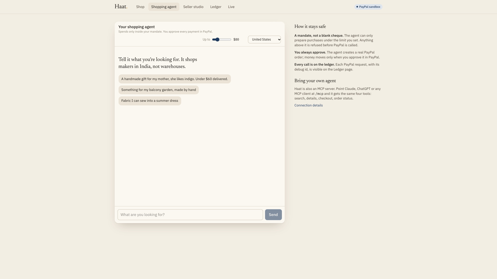 | 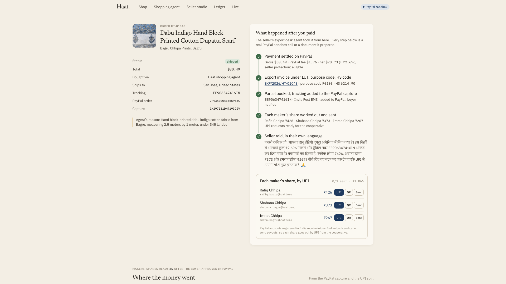 |
| **Buyer's agent.** A real PayPal order, prepared inside the mandate, waiting for a human. | **Where the money went.** The capture, the fees and every maker's share. |
| 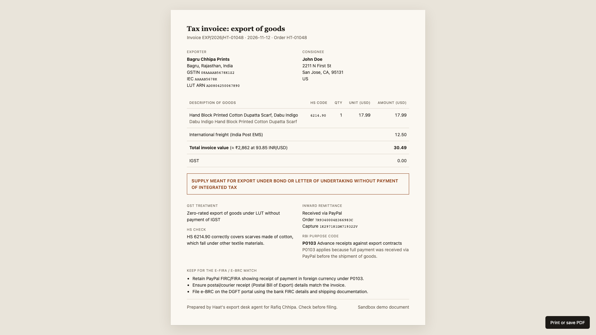 | 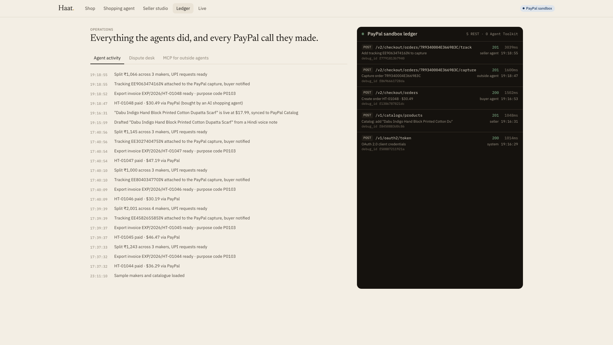 |
| **Export invoice.** GST under LUT, purpose code P0103, HS code checked. | **Ledger.** Every PayPal request, live, with its `PayPal-Debug-Id`. |

The full demo video (2:20, 1080p) is in [`docs/submission/haat-demo.mp4`](docs/submission/haat-demo.mp4).

<br>

## Run it

You need **Node 22.13+** (24 recommended), a free **PayPal developer** account and a **Gemini API key**.

```bash
npm install
```

```bash
cp .env.example .env
```

<details>
<summary><b>What to put in <code>.env</code></b></summary>

<br>

- `PAYPAL_CLIENT_ID`, `PAYPAL_CLIENT_SECRET`: developer.paypal.com → Apps & Credentials → **Sandbox** → Create App. In the app's features, enable Invoicing, Payouts and Transaction search.
- `PAYOUT_MODE`: `upi` if the sandbox business account is registered in India, `paypal` for a marketplace account outside India, `auto` to learn from the first refusal.
- `GEMINI_API_KEY`: aistudio.google.com/apikey.
- Approving test payments needs a sandbox **Personal account outside India** (an Indian merchant cannot take a domestic Indian payment). Create one under developer.paypal.com → Testing Tools → Sandbox Accounts.
- Never commit `.env`. It is already in `.gitignore`.

</details>

```bash
npm run build
```

```bash
npm start
```

Open **http://localhost:8787**. The sample makers and catalogue load on first boot and are mirrored into your PayPal sandbox catalogue.

| Where | What |
|---|---|
| `/` | the scroll-driven landing page |
| `/app/live` | the whole loop on one screen |
| `/app/seller/bagru-chhipa-prints` | seller studio: voice + photo to listing |
| `/app/agent` | the buyer's shopping agent |
| `/app/shop` | the shop, with PayPal checkout |
| `/app/ledger` | every PayPal call, the dispute desk, MCP |
| `POST /mcp` | the MCP endpoint for outside agents |

<details>
<summary><b>Frontend work, smoke tests, demo reset and deploying</b></summary>

<br>

- **Hot reload:** `npm run dev` (API on 8787) and `npm run dev:web` (Vite on 5173, proxied).
- **Check every PayPal API Haat uses:** `cd server && npx tsx --env-file=../.env scripts/smoke-paypal.ts`
- **Reset the demo:** `POST /api/demo/reset`. On a hosted deployment set `DEMO_RESET_TOKEN` and send `{ "token": "..." }`.
- **Deploy:** [`render.yaml`](render.yaml) is a Render blueprint: one Node web service that builds the React app and serves the API, the app and the landing page. Set `PUBLIC_URL` to the service's https URL. On first boot Haat registers a PayPal webhook and prints its id; set that as `PAYPAL_WEBHOOK_ID` so signatures are verified.

</details>

<br>

## What is real and what is simulated

| ✅ Real | 🧪 Simulated | 📐 Estimated |
|---|---|---|
| Every PayPal call (sandbox) | India Post booking: EMS-format tracking numbers are attached to the real capture, but no parcel is booked | PayPal's fee (4.4% + $0.30), labelled in the UI |
| Every Gemini call | WhatsApp transport: the seller chat is a web chat built to look like the phone the maker already uses | GST on fees |
| The pricing maths | Maker payout emails are sample addresses, so sandbox Payouts land unclaimed | the ~3.5% conversion spread |
| The documents generated | Maker UPI IDs use a demo handle (`@haatdemo`) that no UPI app routes | |

Meera Devi, Rafiq Chhipa and Kalaiselvi Murugan are **illustrative profiles**, not real businesses. GSTIN, IEC and LUT numbers are format-valid placeholders. Product photos are stock photography ([credits](server/seed/images/CREDITS.md)). The export invoice is a working draft for the seller to check, not tax advice.

<br>

## Stack

| Layer | Technology |
|---|---|
| Server | Node 24, Express 5, TypeScript (run with `tsx`), SQLite via `node:sqlite`, Server-Sent Events |
| Payments | PayPal REST (Orders v2, Catalog, Payouts, Invoicing, Disputes, Webhooks), JS SDK, `@paypal/agent-toolkit` |
| AI | Google Gemini via `@google/genai`: multimodal structured output, tool-calling agents, TTS |
| Agents | `@modelcontextprotocol/sdk` (Streamable HTTP) |
| Web | React 19, Vite, Tailwind CSS 4. Paper and ink, natural indigo, madder and turmeric. Newsreader and IBM Plex, including Plex Devanagari |

<details>
<summary><b>Repository map</b></summary>

<br>

```
server/src/paypal/     REST client with ledger hook; Orders, Catalog, Tracking, Payouts, Disputes, Webhooks; Agent Toolkit adapter
server/src/agents/     listing (photo + voice → listing), seller chat agent, buyer shopping agent, autopilot, dispute desk
server/src/domain/     commerce, export pricing, export invoice, voice
server/src/mcp/        MCP server for outside agents (POST /mcp)
web/src/pages/         Live stage, seller phone, shopping agent, shop, order, ledger
web/src/MoneyFlow.tsx  every dollar traced
web/src/UpiSplit.tsx   the UPI split
site/                  the scroll-driven landing page (static HTML, CSS, JS)
docs/                  Devpost text, demo script, QA report, gallery and the demo video
```

</details>

<br>

<div align="center">

<sub>Built for the <b>PayPal AI Hackathon 2026</b>. Everything runs against the PayPal sandbox with real API calls.</sub><br>
<sub>A <i>haat</i> is a market. Released under the <a href="LICENSE">MIT licence</a>.</sub>

</div>
